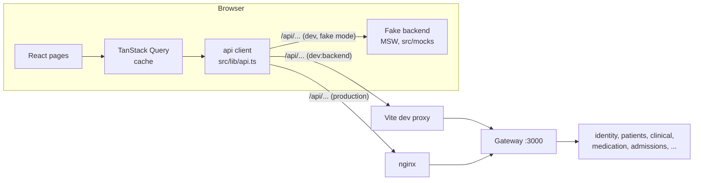
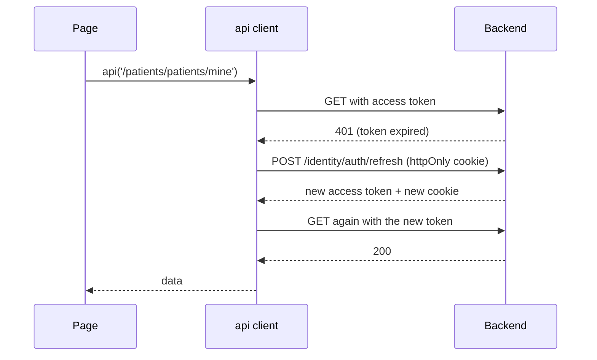
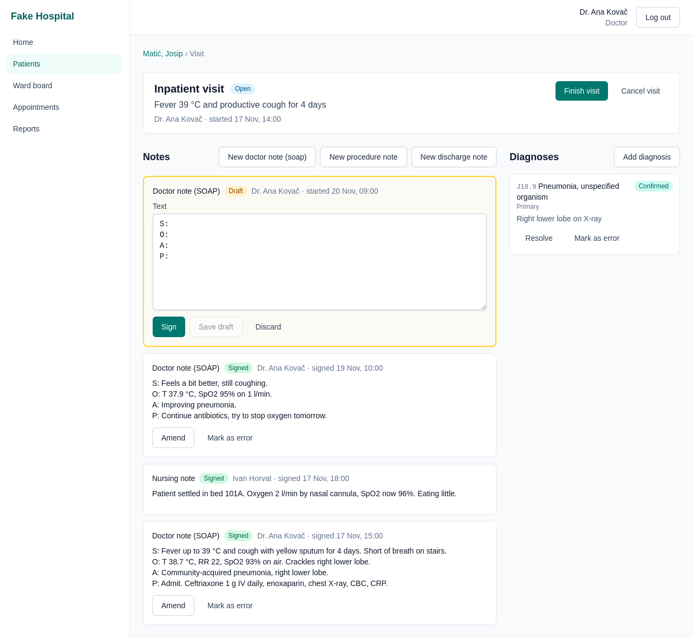
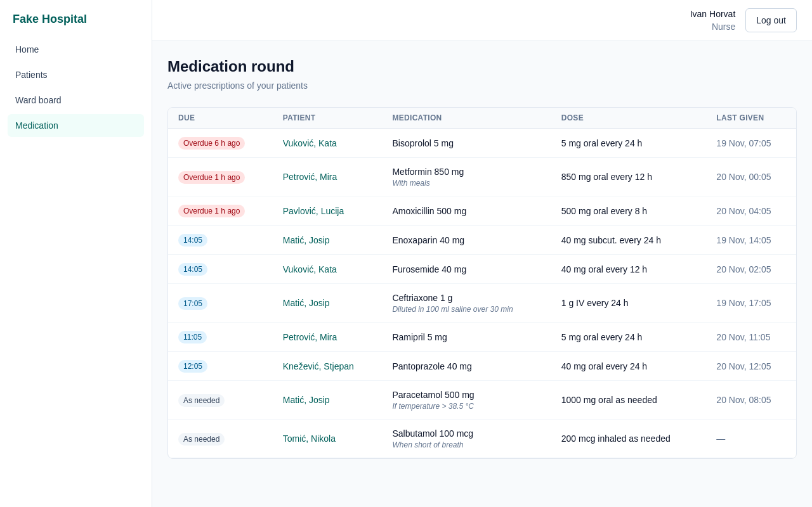
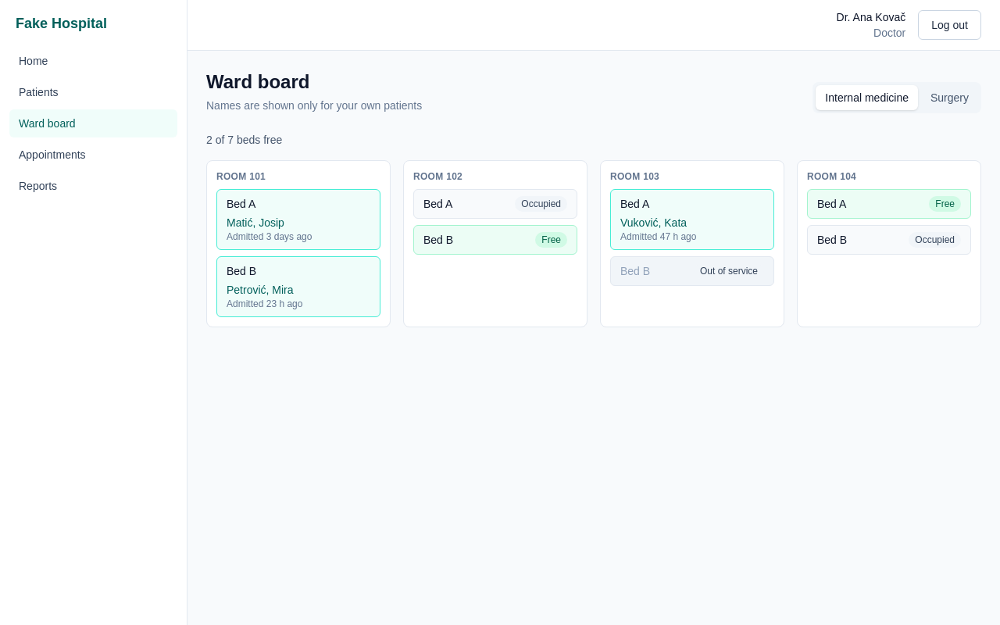

# fe-fake-hospital

Staff web app for the [fake-hospital](https://github.com/FrankDev-327/fake-hospital) backend: a paperless hospital where doctors, nurses, the lab, the pharmacy, the front desk and admins each get their own screens.

For now it runs on a **fake backend** inside the browser, so it works without starting the microservices. The fake answers copy the real API (same URLs, bodies and error codes), so switching to the real backend later is a config change. Plan and progress: [docs/plan.md](docs/plan.md).


## Run it

```bash
nvm use            # Node 24 (.nvmrc)
pnpm install
pnpm dev           # http://localhost:5173 with the fake backend
```

On the login page, click a role in the yellow **Demo mode** box (password `demo-password` for all):

| Demo user | Role | What they see |
|---|---|---|
| Dr. Ana Kovač | Doctor | Her 6 patients, charts, visits, notes, diagnoses, prescribing, lab orders, ward board, appointments, reports |
| Ivan Horvat | Nurse | Dr. Kovač's patients, medication round, doses, vitals, nursing notes, ward board |
| Marija Babić | Lab technician | Lab worklist: collect samples, enter results (patient ids only, no charts) |
| Petra Novak | Pharmacist | Drug catalog |
| Luka Jurić | Receptionist | Patient search, register and edit patients, contacts, doctors' schedules |
| Tomislav Perić | Admin | Staff list, reports (no clinical data) |

Changes you make (a registered patient, a signed note...) are kept in the browser and survive a reload. **Reset demo data** on the login page brings back the starting data.

Other scripts:

```bash
pnpm test          # Vitest + Testing Library, against the same fake backend
pnpm lint          # ESLint
pnpm typecheck     # TypeScript
pnpm build         # production build (the fake backend is left out)
pnpm dev:backend   # same app, /api goes to the real gateway on :3000
```

## How it works



- **One API client** (`src/lib/api.ts`). Every request goes to `/api/...` on the app's own address, so there's no CORS. In development Vite forwards it to the gateway; in production nginx will.
- **Login and tokens.** The access token (15 min) lives only in memory, never in localStorage. The refresh token is an **httpOnly cookie** set by the backend, which page scripts can't read. When a request gets 401, the client refreshes **once**: parallel requests share one refresh, and tabs take turns using the Web Locks API, because the backend treats a reused refresh token as theft. After a reload the app calls refresh to stay logged in. Staff are logged out after 15 minutes without activity.
- **Server data** goes through TanStack Query (`useQuery` to read, `useMutation` to change). After a change, the related cache is refreshed so every screen shows the new data. Logout clears the whole cache, so no patient data is left behind.
- **Pages and access.** TanStack Router has a login check on all pages and a role check on each section. This is only for the UI: the backend enforces access again (wrong role = 403, not your patient = 404).
- **Forms.** React Hook Form + Zod, with the same rules as the backend's DTOs (OIB check digit, date ranges, vital sign limits...), so mistakes show while typing.
- **Backend rules shown in the UI.** The app handles the backend's answers instead of just showing "error". For example: prescribing is blocked by an allergy until the doctor writes a reason; a dose given too soon needs confirmation; a visit can't be finished while a note is unsigned; editing a patient someone else just changed asks you to reload.



### The fake backend

`src/mocks/` uses [MSW](https://mswjs.io) (Mock Service Worker), which answers the app's requests inside the browser:

- `data/`: starting data (staff, patients, visits, notes, prescriptions, vitals, LOINC lab tests with the backend's ranges, ICD-10 codes)
- `handlers/`: one file per backend service, with the same roles, access checks, validation and error codes as the real one
- `db.ts`: the records the app can change, saved in localStorage

The same handlers run in the tests (`msw/node`), so tests go through the real pages, router and API client. The production build doesn't include any of this.

## Screens

| | |
|---|---|
|  |  |
| Login with the demo accounts | A visit: notes (draft, sign, amend), diagnoses |
|  |  |
| Prescribing stopped by a penicillin allergy | Vitals trend and a critical result waiting for a doctor |
|  |  |
| Nurse's medication round, overdue first | Lab technician entering results, flag shown while typing |
|  | |
| Ward board: names only for your own patients | |

## Stack

React 19, TypeScript, Vite, TanStack Router, TanStack Query, React Hook Form, Zod, Tailwind CSS, Recharts, MSW, Vitest, Testing Library, pnpm.

## Project structure

```
src/
  main.tsx          entry: query cache, toasts, auth, app (starts the fake backend in dev)
  App.tsx           waits for the session check, then mounts the router
  router.tsx        all pages + login and role checks
  lib/api.ts        the only place that calls the backend (tokens, refresh, errors)
  auth/             who is logged in, login/logout, idle logout
  app/nav.ts        menu per role
  features/         one folder per area: api.ts (queries/mutations) + pages and dialogs
    patients/ clinical/ medication/ vitals/ lab/ ward/ appointments/ admin/ reports/ staff/
  components/       shared UI: buttons, fields, modal, tables, toasts
  hooks/            small hooks (debounce, current time)
  mocks/            fake backend: data/, handlers/, db.ts
  test/             test setup and the renderApp() helper
```

## Status

Done (on the fake backend): login and roles, patients (register, edit, contacts), visits, notes, diagnoses, medication (prescribing with safety checks, doses), vitals, lab (orders, collection, results, critical results). Every role's pages can be viewed.

Next: admissions and the live ward board, documents and printing, appointments, admin, then connecting to the real backend, Playwright tests and Docker. Backend endpoints the frontend still needs are listed in [docs/plan.md](docs/plan.md) ("Backend gaps").
