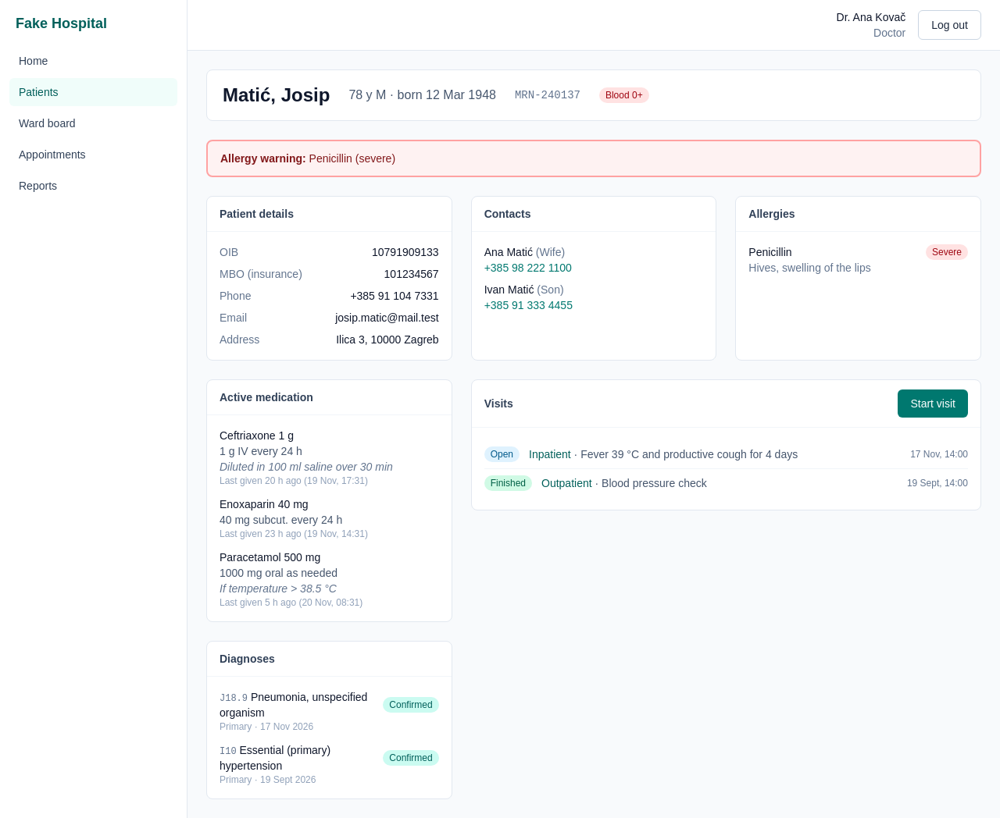
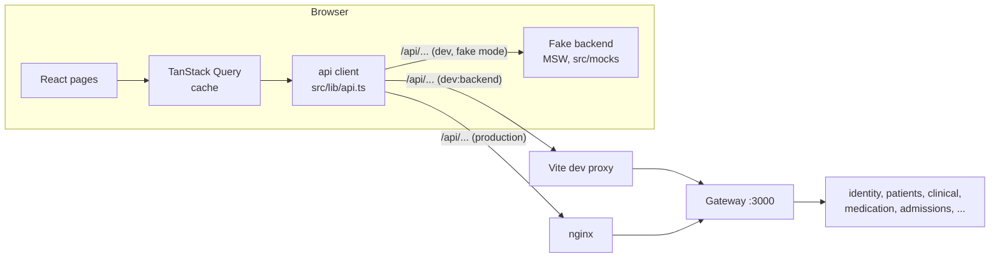
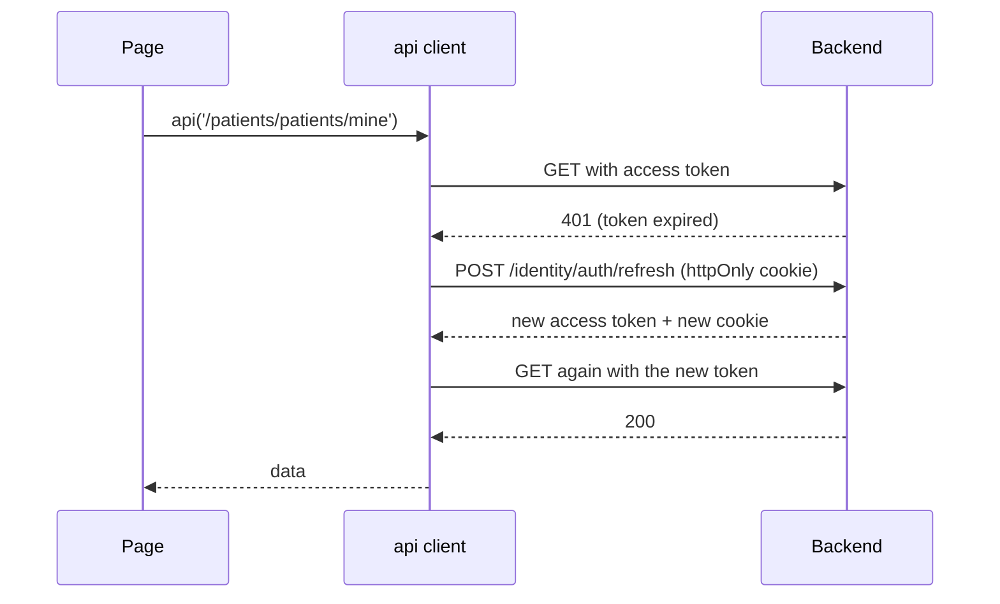
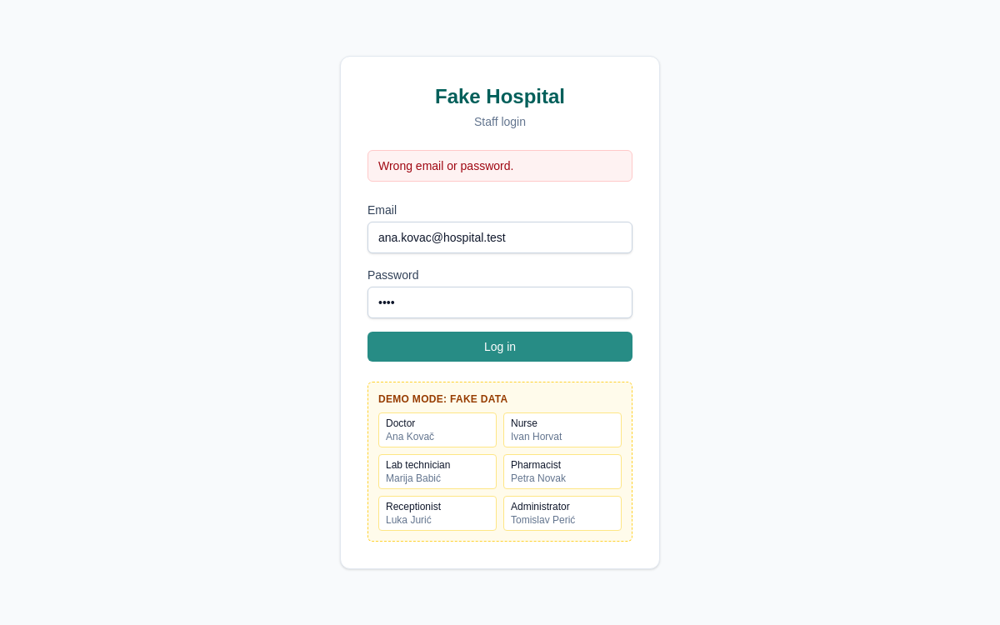
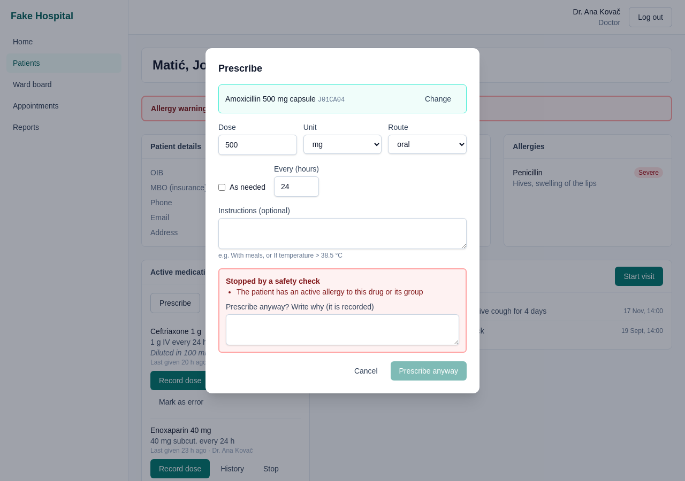
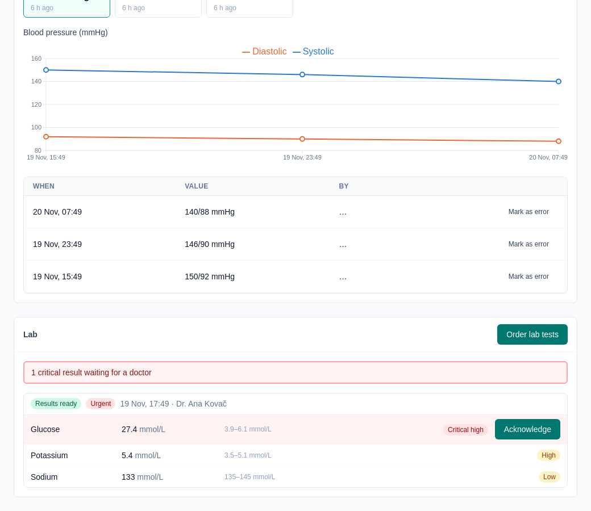
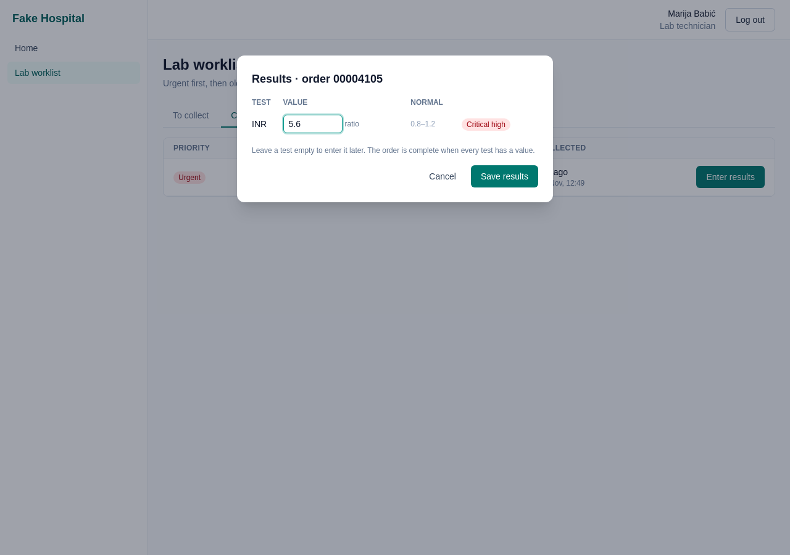
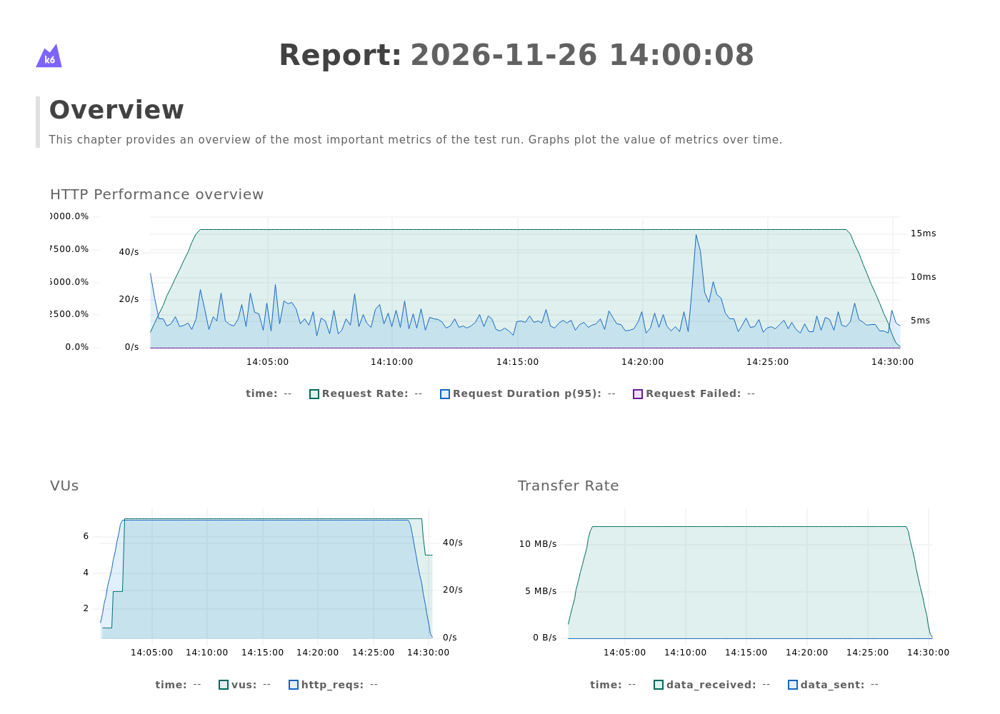
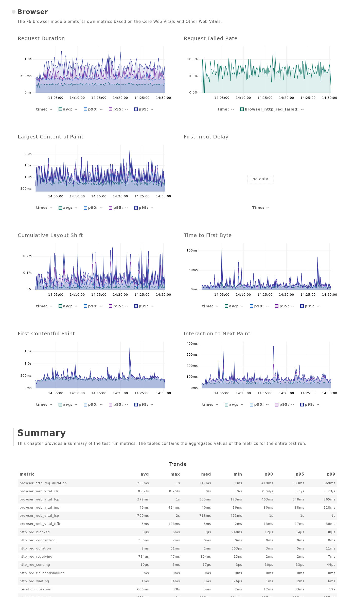
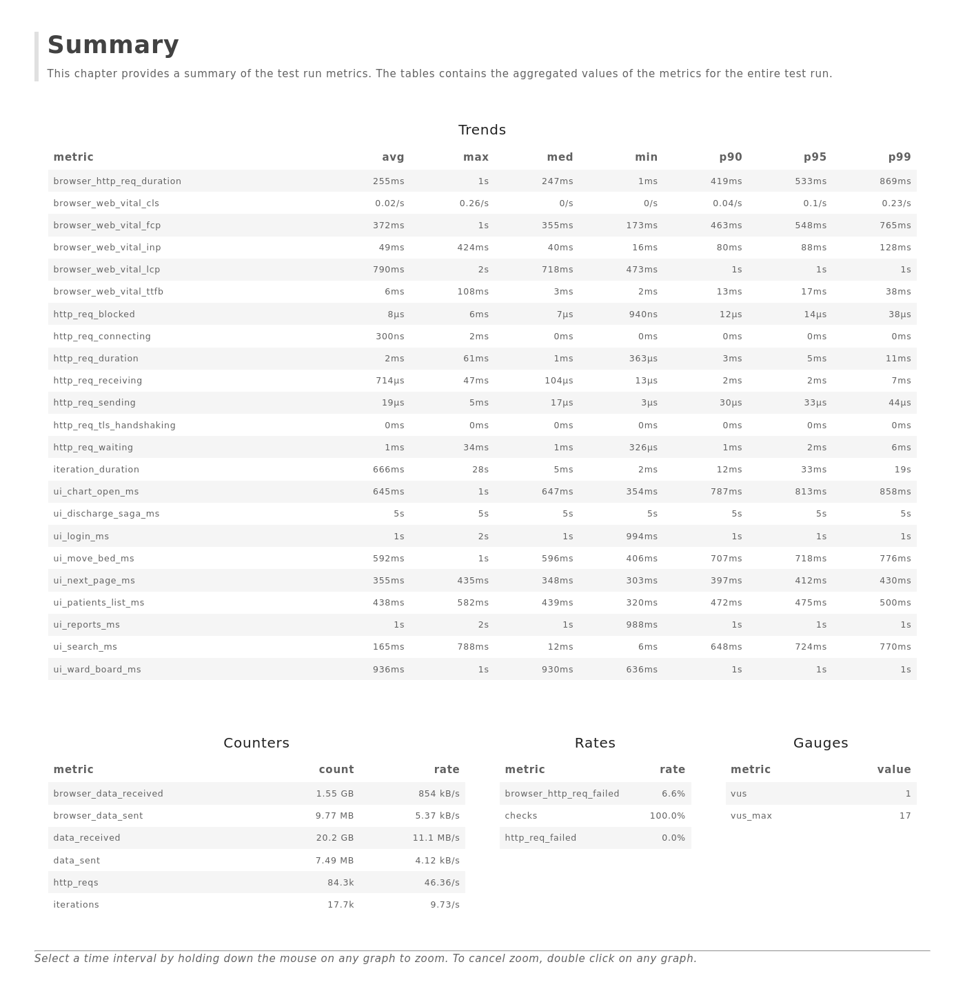

# fe-fake-hospital

Staff web app for the [fake-hospital](https://github.com/FrankDev-327/fake-hospital) backend: a paperless hospital where doctors, nurses, the lab, the pharmacy, the front desk and admins each get their own screens.

For now it runs on a **fake backend** inside the browser, so it works without starting the microservices. The fake answers copy the real API (same URLs, bodies and error codes), so switching to the real backend later is a config change. Plan and progress: [docs/plan.md](docs/plan.md).



## Run it

```bash
nvm use            # Node 24 (.nvmrc)
pnpm install
pnpm dev           # http://localhost:5173 with the fake backend
```

On the login page, click a role in the yellow **Demo mode** box (password `demo-password` for all):

| Demo user | Role | What they see |
|---|---|---|
| Dr. Ana Kovač | Doctor | Her 6 patients, charts, visits, notes, diagnoses, prescribing, lab orders, ward board, appointments, reports |
| Ivan Horvat | Nurse | Dr. Kovač's patients, medication round, doses, vitals, nursing notes, ward board |
| Marija Babić | Lab technician | Lab worklist: collect samples, enter results (patient ids only, no charts) |
| Petra Novak | Pharmacist | Drug catalog |
| Luka Jurić | Receptionist | Patient search, register and edit patients, contacts, doctors' schedules |
| Tomislav Perić | Admin | Staff list, reports (no clinical data) |

Changes you make (a registered patient, a signed note...) are kept in the browser and survive a reload. **Reset demo data** on the login page brings back the starting data.

Other scripts:

```bash
pnpm test          # Vitest + Testing Library, against the same fake backend
pnpm lint          # ESLint
pnpm typecheck     # TypeScript
pnpm build         # production build (the fake backend is left out)
pnpm dev:backend   # same app, /api goes to the real gateway on :3000
```

## How it works



- **One API client** (`src/lib/api.ts`). Every request goes to `/api/...` on the app's own address, so there's no CORS. In development Vite forwards it to the gateway; in production nginx will.
- **Login and tokens.** The access token (15 min) lives only in memory, never in localStorage. The refresh token is an **httpOnly cookie** set by the backend, which page scripts can't read. When a request gets 401, the client refreshes **once**: parallel requests share one refresh, and tabs take turns using the Web Locks API, because the backend treats a reused refresh token as theft. After a reload the app calls refresh to stay logged in. Staff are logged out after 15 minutes without activity.
- **Server data** goes through TanStack Query (`useQuery` to read, `useMutation` to change). After a change, the related cache is refreshed so every screen shows the new data. Logout clears the whole cache, so no patient data is left behind.
- **Pages and access.** TanStack Router has a login check on all pages and a role check on each section. This is only for the UI: the backend enforces access again (wrong role = 403, not your patient = 404).
- **Forms.** React Hook Form + Zod, with the same rules as the backend's DTOs (OIB check digit, date ranges, vital sign limits...), so mistakes show while typing.
- **Backend rules shown in the UI.** The app handles the backend's answers instead of just showing "error". For example: prescribing is blocked by an allergy until the doctor writes a reason; a dose given too soon needs confirmation; a visit can't be finished while a note is unsigned; editing a patient someone else just changed asks you to reload.



### The fake backend

`src/mocks/` uses [MSW](https://mswjs.io) (Mock Service Worker), which answers the app's requests inside the browser:

- `data/`: starting data (staff, patients, visits, notes, prescriptions, vitals, LOINC lab tests with the backend's ranges, ICD-10 codes)
- `handlers/`: one file per backend service, with the same roles, access checks, validation and error codes as the real one
- `db.ts`: the records the app can change, saved in localStorage

The same handlers run in the tests (`msw/node`), so tests go through the real pages, router and API client. The production build doesn't include any of this.

## Screens

| | |
|---|---|
|  |  |
| Login with the demo accounts | A visit: notes (draft, sign, amend), diagnoses |
|  |  |
| Prescribing stopped by a penicillin allergy | Vitals trend and a critical result waiting for a doctor |
|  |  |
| Nurse's medication round, overdue first | Lab technician entering results, flag shown while typing |
|  | |
| Ward board: names only for your own patients | |

## Load test (k6)

`load-tests/` has a 30 minute frontend load test: **real Chromium tabs** (k6 browser) click through the app like staff do, while plain HTTP traffic downloads the app files. The app is a production build **with the fake backend inside** (`pnpm build:demo`), so this measures the frontend itself: page loads, Web Vitals, how long each screen takes to appear, the discharge saga on screen. The real backend has its own k6 test in the backend repo.

```bash
pnpm load-test                  # build:demo, serve on :4173, run 30 min, stop the server
DURATION_MIN=5 pnpm load-test   # short run
```

While it runs: **live dashboard at http://localhost:5665**. After: `load-tests/results/` has the dashboard report (`k6-fe-dashboard-*.html`, open it in a browser), plus k6's text/HTML/JSON summaries. Needs `k6` and a Chromium (`K6_BROWSER_EXECUTABLE_PATH`, default the Playwright one in `~/.cache/ms-playwright`).

| Scenario | Users | What one iteration does |
|---|---|---|
| doctor | 2 tabs | log in, patients list, page 2, open 2 charts (one via "Back to patients"), ward board, Cardiology and Neurology tabs |
| nurse | 2 tabs | ward board, move a patient to a free bed, open a chart from the board |
| reception | 1 tab | 4 patient searches, open a patient |
| reports | 1 tab | reports dashboard until the charts are drawn |
| discharge | 1 tab | discharge a patient, follow the saga's steps, check the bed is free on the board |
| static | up to 10/s | `index.html` + every JS/CSS file + the service worker |

2 min ramp up, 26 min steady, 2 min ramp down. Every browser iteration is a new browser profile (new person, fresh fake data).

### Load test results (k6, 2026-11-26)

One 30 min run on a laptop (8 cores, 16 GB), app served by `vite preview`. **Every threshold passed.**

| | Result | Threshold |
|---|---|---|
| Iterations / requests | 17,686 iterations, 84,301 HTTP requests (46/s), 1.55 GB loaded by the browsers | |
| Checks | **100%** | > 99% ✓ |
| Failed user flows / JS errors in the page | **0 / 0** | < 5 / 0 ✓ |
| Largest Contentful Paint (LCP) | median 718 ms, p90 1.19 s | p75 < 2.5 s ✓ |
| First Contentful Paint (FCP) | median 356 ms, p90 464 ms | p75 < 1.8 s ✓ |
| Cumulative Layout Shift (CLS) | median 0.00, p90 0.04 | p75 < 0.1 ✓ |
| Interaction to Next Paint (INP) | median 40 ms, p90 80 ms | p75 < 200 ms ✓ |
| Log in (type, click, until the app shows) | p95 1.71 s | < 3 s ✓ |
| Patients list / next page | p95 476 ms / 413 ms | < 2 s / < 500 ms ✓ |
| Open a patient chart | p95 **813 ms** | < 2 s ✓ |
| Ward board | p95 1.15 s | < 2 s ✓ |
| Move to another bed (submit until "Patient moved") | p95 719 ms | < 2 s ✓ |
| Patient search | p95 724 ms (median 12 ms: often already cached) | < 2 s ✓ |
| Reports dashboard (charts drawn) | p95 1.55 s | < 3 s ✓ |
| Discharge saga on screen (2 steps + bed freed) | p95 5.6 s | < 8 s ✓ |
| App files (`static`) | p95 **5 ms**, 0% failed | p95 < 300 ms, < 1% ✓ |

The Web Vitals thresholds are at p75 (how Google measures them); the dashboard only keeps p90/p95/p99, and those are already under the p75 limits.

**What the numbers mean:**
- Screen times include the fake backend's built-in delay (each fake request waits a little, like a network), so they're closer to real use than a no-delay mock. Most of a screen's time is that waiting; the app's own work (drawing) is small, which INP (p90 80 ms) shows.
- The discharge takes ~5.5 s because the fake saga waits 1.5 s per step on purpose, so the steps can be seen on screen.
- `browser_http_req_failed` 6.6% is not errors: it's the expected `401` of the session check when a page opens before login (each iteration is a new profile).
- The graphs stay flat for the whole 26 minutes: later iterations are not slower than the first ones.

**Limits of this test:**
- **Live updates across tabs are not in it.** k6's browser connects the live stream (the "Live" dot turns green) but never delivers the pushed messages to the page. The same build in Playwright with the same Chromium gets them in ~30 ms (discharge in one tab, the ward board in another tab frees the bed), so the app works; it's a k6 browser limit. The discharge scenario covers the saga in one tab instead (the chart polls every 2 s while a discharge runs).
- k6 didn't exit after the last iteration (stuck closing a browser) and was stopped with Ctrl+C, so its own end-of-test summary wasn't written. The dashboard report has everything; [`k6-fe-2026-11-26-summary.txt`](load-tests/results/k6-fe-2026-11-26-summary.txt) is extracted from it.
- `vite preview` is a simple static server, not nginx; the real nginx setup (gzip, caching) comes with the Docker step.

**Overview** (requests, users, transfer, durations):



**Browser** (Web Vitals over time):



**Summary** (all metrics for the whole run):



## Stack

React 19, TypeScript, Vite, TanStack Router, TanStack Query, React Hook Form, Zod, Tailwind CSS, Recharts, MSW, Vitest, Testing Library, pnpm.

## Project structure

```
src/
  main.tsx          entry: query cache, toasts, auth, app (starts the fake backend in dev)
  App.tsx           waits for the session check, then mounts the router
  router.tsx        all pages + login and role checks
  lib/api.ts        the only place that calls the backend (tokens, refresh, errors)
  auth/             who is logged in, login/logout, idle logout
  app/nav.ts        menu per role
  features/         one folder per area: api.ts (queries/mutations) + pages and dialogs
    patients/ clinical/ medication/ vitals/ lab/ ward/ appointments/ admin/ reports/ staff/
  components/       shared UI: buttons, fields, modal, tables, toasts
  hooks/            small hooks (debounce, current time)
  mocks/            fake backend: data/, handlers/, db.ts
  test/             test setup and the renderApp() helper
load-tests/         k6 frontend load test (main.js, run.sh, results/)
```

## Status

Done (on the fake backend): login and roles, patients (register, edit, contacts), visits, notes, diagnoses, medication (prescribing with safety checks, doses), vitals, lab (orders, collection, results, critical results). Every role's pages can be viewed.

Next: admissions and the live ward board, documents and printing, appointments, admin, then connecting to the real backend, Playwright tests and Docker. Backend endpoints the frontend still needs are listed in [docs/plan.md](docs/plan.md) ("Backend gaps").
